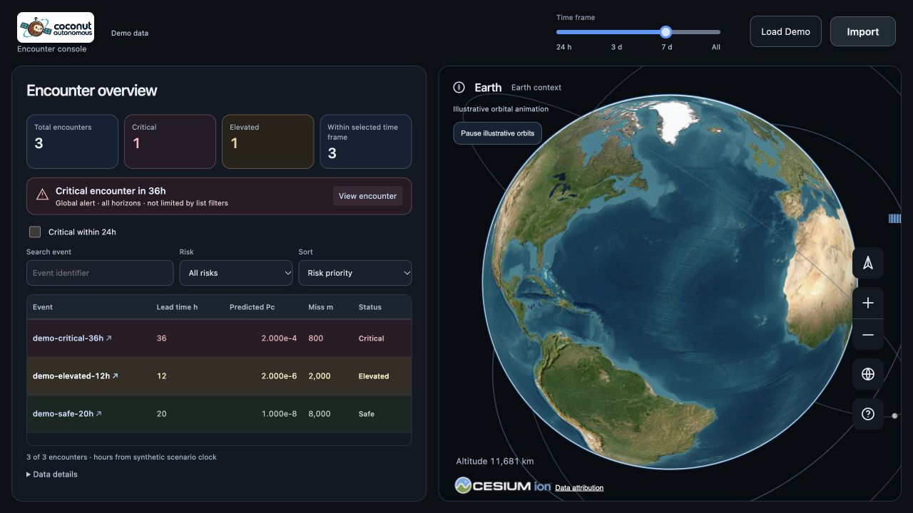
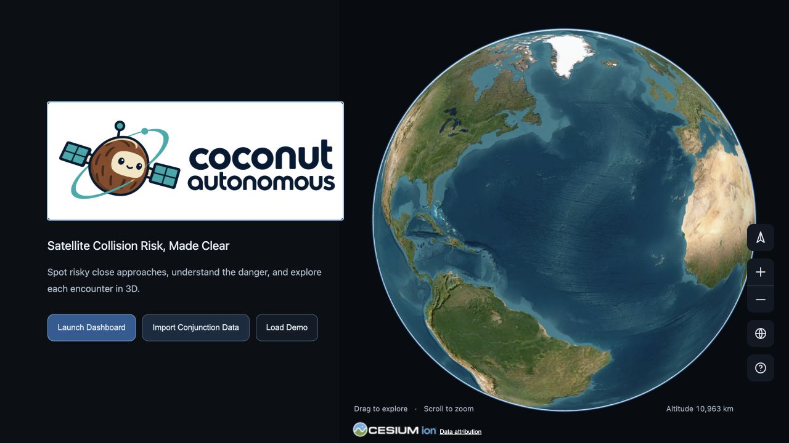
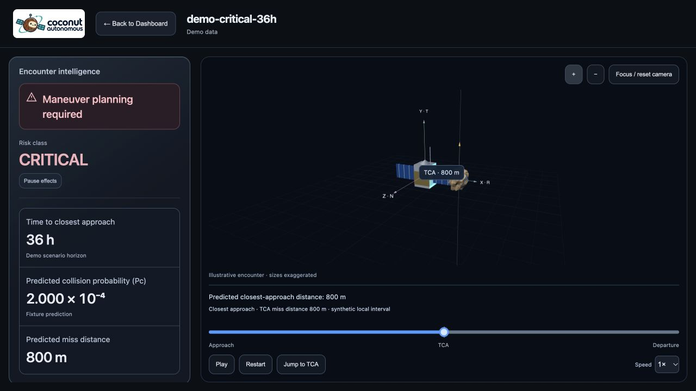
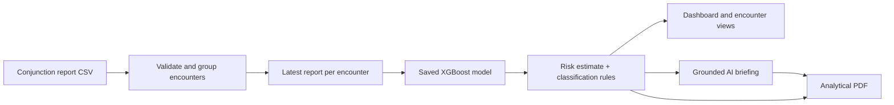

<div align="center">


# Coconut Autonomous

### Satellite collision risk, made clear.

Turn conjunction reports into a prioritized view of satellite encounters—
with learned risk estimates, interactive geometry and AI-assisted briefings.

**[Watch the live demo](https://www.youtube.com/watch?v=QCxIsH1zZBE) · [Explore the product](#inside-the-console) · [Run locally](#run-locally) · [ML results](#ml-training-and-benchmark-evidence) · [Data and limits](#data-and-interpretation)**


</div>

---

## Live demo

[Watch the Coconut Autonomous live demo on YouTube](https://www.youtube.com/watch?v=QCxIsH1zZBE).

## From encounter reports to a review decision

Satellite operators need to know which close approaches deserve attention, what drives the assessment and which evidence to review next. Coconut Autonomous brings those questions into one console.

Upload a CSV or open the labeled demo. The application groups reports by encounter, estimates risk from the latest telemetry, applies explicit probability and separation rules, and presents the results alongside an interactive Earth view. Open an encounter to inspect its metrics, illustrative geometry and grounded AI explanation. Export a full analytical PDF when the assessment needs to travel beyond the dashboard.

| Prioritize | Inspect | Explain | Share |
| --- | --- | --- | --- |
| Global critical alerts, search, sorting and review horizons | Pc, miss distance, source provenance and 3D encounter views | AI review advice tied to the stored assessment | Analytical PDF with portfolio findings and what-if comparisons |

## Inside the console

### A clear view of what deserves attention



*The global critical banner covers every horizon. A critical encounter at 36 hours stays visible even when the list is filtered to critical encounters within 24 hours.*

<table>
<tr>
<td width="50%"></td>
<td width="50%"></td>
</tr>
<tr>
<td><strong>Start with context.</strong> Open the demo or import conjunction reports.</td>
<td><strong>Inspect the encounter.</strong> Review its probability, separation and illustrative geometry.</td>
</tr>
</table>

*Screenshots show the running product using labeled synthetic demo data. Orbital illustrations are not observed satellite positions.*

### What you can do

- **Import reports, keep their provenance.** Repeated event IDs become encounter histories; the latest report supplies the displayed telemetry and model input. Reported Pc and predicted Pc remain separate.
- **Triage across time horizons.** Search, filter and sort encounters by risk, time to closest approach, probability or miss distance. List filters do not suppress the global critical alert.
- **Inspect the relative situation.** Explore the 3D view and closest-approach playback where the required vectors are available. Illustrative assumptions and missing motion data are labeled.
- **Get grounded AI insights.** The algorithm supplies risk facts and severity. Claude selects supported review advice and writes the broader analytical briefing; missing AI access does not hide numeric results.
- **Download an analytical report.** Export portfolio statistics, priority encounters, advisory actions, evidence references and independent what-if comparisons as a PDF.
- **See missing evidence honestly.** Invalid CSV rows, unavailable predictions and missing geometry are explicit states, rather than fabricated values.

## How it works



The saved model estimates **per-report `risk = log10(Pc)`**. The API converts it to Pc and applies the configured rules using the source miss distance. Uploads reuse the saved model and encoder; they do not retrain the model.

| Tier | Configured assessment rule |
| --- | --- |
| **Critical** | Pc ≥ `1e-4` **or** miss distance < `1,000 m` |
| **Unknown** | Required evidence is missing and no known Critical criterion applies |
| **Elevated** | With complete evidence, after Critical is ruled out: Pc ≥ `1e-6` **or** miss distance ≤ `5,000 m` |
| **Safe** | Pc < `1e-6` **and** miss distance > `5,000 m` |

Critical takes precedence. A Safe tier is an assessment label, not operational clearance. The LLM does not calculate a new Pc or override the algorithm's tier.

## ML training and benchmark evidence

The current **cost-sensitive XGBoost model** prioritizes detection of rare high-risk reports. Its increased sensitivity comes with more false positives and higher numerical error.

| Evaluation | Earlier unweighted model | Current weighted model |
| --- | ---: | ---: |
| **Critical probability recall · event-separated holdout** | 3.62% | **60.14%** |
| **Critical probability recall · supplied-test reports** | 16.74% | **53.65%** |
| Combined-tier agreement · supplied-test reports | 95.45% | **87.87%** |
| Distance-only tier agreement · supplied-test reports | 95.44% | 95.44% |

> [!IMPORTANT]
> Probability-only recall and combined-tier agreement measure different things. The distance rule can determine a tier regardless of the predicted Pc. These scores are not accuracy guarantees for physical collisions, and the weighted estimates are not calibrated collision probabilities.

<details>
<summary><strong>Full ML evidence: data splits, loss function, selected costs, all benchmark tables and reproducibility</strong></summary>


### Current model and cost-sensitive training

The deployed model is an **XGBoost regressor for each report's `risk = log10(Pc)`**.
Its trees learn nonlinear relationships between telemetry and source-reported risk.
A deterministic function maps the estimate and miss distance to **Safe**,
**Elevated risk**, or **Critical**. This estimates the current report's risk;
it does not forecast the final report at TCA or observed collision occurrence.

Training uses **162,634 reports from 13,154 events**, with exactly these inputs:

```text
event_id,time_to_tca,miss_distance,relative_speed,relative_position_r,relative_position_t,relative_position_n,c_object_type,c_sigma_r,t_sigma_r,F10,AP
```

Object type is one-hot encoded on the fitting partition only. Unknown categories
use all-zero indicators; numeric missing values use native XGBoost branches.
The target is already logarithmic and is not logged again.

All reports from one event stay in the same partition (fixed seeds 42 and 43):

| Partition | Events | Reports | Use |
| --- | ---: | ---: | --- |
| Fit, approximately 64% of events | 8,418 | 104,230 | Learn encoding, costs and trees |
| Validation, approximately 16% | 2,105 | 26,366 | Select costs and boosting rounds |
| Holdout, approximately 20% | 2,631 | 32,038 | Assessment after selection |

Only **425 fitting reports** have `risk >= -4`. Ordinary squared-error training
largely missed them. The replacement uses **frequency-adaptive sample weights**
with XGBoost's native weighted squared-error objective:

```text
band(y) = Safe if y < -6; Elevated if -6 <= y < -4; Critical if y >= -4
raw_weight(band) = [n / (number_of_present_bands * band_count)] ** power
                   * band_multiplier
weight = raw_weight / mean_fitting_row_weight
loss = 0.5 * sum(weight * (prediction - true_risk) ** 2)
```

Weights depend on fitting labels only. A bounded search compares the unweighted
baseline with nine weighted candidates: Elevated multipliers 5, 20, or 80;
Critical multipliers 1, 4, or 16 times the Elevated multiplier; balance power 1.
Early stopping and candidate selection minimize
`1 - (minimum_band_recall + 0.05 * macro_band_recall) / 1.05`.
These probability-band recalls **ignore distance**, preventing distance overrides
from hiding missed high-Pc cases. A one-class prediction has zero minimum recall.
Candidates must also beat the fit-mean constant's validation RMSE (**10.0719**).
If none pass, training fails explicitly instead of silently exporting a bad model.

The selected multipliers are **Safe 1, Elevated 20, Critical 320**, with power 1.
After frequency correction and normalization, fitting row weights are
**0.003122, 1.034732, and 230.143868** respectively. The same squared error on
a true Critical report therefore costs approximately **73,711 times** the error
on a true Safe report. This heavily penalizes missed Critical cases, while also
weighting other errors on true Critical rows; it is a class-weighted objective,
not an implementation that changes inference thresholds.

Histogram boosting retains learning rate 0.04, depth 7, minimum child weight 8,
row/column sampling 0.85/0.90, L1 0.05 and L2 8.0. The budget is 1,600 rounds,
with patience 80. Validation selected **125 rounds**, minimum band recall
**66.57%**, macro recall **72.80%**, and log-risk RMSE **9.8092**.

The final model refits all training reports at the selected costs and round count,
recomputing frequency weights on that final fitting set. Upload inference needs
only the saved model and encoder, with no training or label-dependent weighting.
Before any prediction, **`risk`, `max_risk_estimate`, and `max_risk_scaling` are
explicitly removed**. Only the twelve allowed features enter inference.
Distances remain in metres, Critical takes precedence, and log-risk is capped at zero.

Implementation: [development/collision_risk.py](development/collision_risk.py).
The [XGBoost fit API](https://xgboost.readthedocs.io/en/stable/python/python_api.html#xgboost.XGBRegressor.fit)
documents sample weighting; its
[estimator guide](https://xgboost.readthedocs.io/en/stable/python/sklearn_estimator.html)
documents callable validation costs and early stopping.

### Did Critical detection improve?

Recall means **correct detections / reference reports in that class**. Overall
accuracy is different: it is matching classes / all reports. The table below
isolates the model's probability bands, without applying distance overrides,
on the same event-separated holdout used for the original baseline:

| Probability band | Reference reports | Unweighted recall | Weighted recall | Weighted precision |
| --- | ---: | ---: | ---: | ---: |
| Safe | 30,007 | 99.30% | **86.33%** | 98.59% |
| Elevated risk | 1,893 | 15.06% | **64.82%** | 23.78% |
| Critical | 138 | 3.62% | **60.14%** | 13.79% |

Critical detections rise from **5/138 to 83/138**; false negatives fall from
**133 to 55** (58.65% fewer). Macro recall rises from **39.33% to 70.43%**.
The gap between the highest and lowest band recall falls from **95.68 to 26.19
percentage points**. This is much more balanced; probability-band recalls are
still unequal, and the prototype still misses 55 of 138 high-Pc reports.

With the operational distance rules applied, holdout recalls are **91.32% Safe,
92.28% Elevated, and 99.15% Critical**. Combined-tier agreement is **92.12%**,
versus 97.32% for the old model. Log-risk RMSE rises from **5.7234 to 9.5750**;
the constant-mean holdout baseline is 10.0084. These are real costs of prioritizing
sensitivity. Higher class costs bias estimates toward higher-risk outcomes;
exponentiating them does **not** establish calibrated collision probabilities.

The assessment model fits only the fit partition. The deployed model subsequently
refits all training data, so that final refit cannot be independently scored on
these training holdout rows.

### Simple accuracy: current data_prediction.csv versus test_data.csv

The benchmark compares the frozen export with same-row reference risk in the
supplied test CSV, checking row order and all twelve inputs. It does not join
on repeated `event_id` alone, train, tune, or invoke the model. Reference tiers
are calculated from the source risk and miss distance using the same rules.

```text
current tier agreement = 21,514 / 24,484 * 100 = 87.87%
```

This is a **retrospective comparison** of 24,484 reports from 2,167 events. Test
labels were previously inspected for baseline benchmarking; this is not a fresh
blind test. They did not select these costs or rounds, and the model was not
retuned after this comparison. It evaluates reported risk, not actual collisions.

| Metric | Prior unweighted export | Current weighted export |
| --- | ---: | ---: |
| Probability-only Critical recall | 16.74% (39/233) | **53.65% (125/233)** |
| Probability-only Critical false negatives | 194 | **108** |
| Probability-only Critical false positives | 114 | **518** |
| Probability-only Critical precision | 25.49% | **19.44%** |
| Overall combined-tier agreement | 95.45% | **87.87%** |
| Log-risk RMSE | 6.0391 | **9.4602** |
| Numerical risk within ±1 log10 unit | 18.84% | **21.77%** |

Current combined-tier precision/recall, including distance:

| Tier | Reference reports | Prior recall | Current recall | Current precision |
| --- | ---: | ---: | ---: | ---: |
| Safe | 15,756 | 99.63% | **85.41%** | 97.84% |
| Elevated risk | 6,501 | 85.09% | **90.57%** | 71.41% |
| Critical | 2,227 | 96.09% | **97.40%** | 87.28% |

The weighted model's probability-only Safe/Elevated/Critical recalls are
**79.44% / 74.95% / 53.65%**. The higher Critical sensitivity comes with more
false alerts and worse numerical RMSE. Distance alone yields **95.44%** combined
tier agreement, higher than this sensitivity-focused model's 87.87%. The new
objective improves rare-case detection and class balance, **not overall accuracy**.
Latest-report-per-event agreement is **95.52%** (2,070/2,167), using the smallest
available `time_to_tca`; this is not final-TCA truth.

### Reading these results responsibly

> The model trains on separated events and explicitly removes risk fields before inference.
> Frequency-adaptive costs make missed high-risk reports expensive. On the event
> holdout, Critical probability recall improves from 3.62% to 60.14%, and average
> recall across probability bands improves from 39.33% to 70.43%. The evaluation discloses the
> additional false alerts, higher regression error, and the remaining missed cases.
> The model is a reproducible decision-support prototype, not a calibrated
> operational collision predictor.

Reports within an event are correlated, and this is not a chronological backtest.
`event_id` is retained because it is explicitly requested, but is an arbitrary
identifier; identifier ablation and fresh grouped/chronological validation remain
future work. Further tuning needs fresh evaluation events rather than repeated
optimization against this holdout/test comparison. Software-test pass rates do
not measure predictive accuracy.

### Reproduce and inspect

With the local training/test CSVs present, execute the notebook or training script:

```bash
development/.venv/bin/python development/execute_notebook.py
# Equivalent training workflow:
development/.venv/bin/python development/collision_risk.py
# Reproduce the original RMSE-only baseline in a separate output directory:
development/.venv/bin/python development/collision_risk.py --unweighted --output-dir development/artifacts/unweighted
```

Training saves to `development/artifacts/`; it does not automatically replace the
deployed model. After reviewing results, promote the model and encoder together
as described in [development/README.md](development/README.md). The deployed
artifact is the weighted model; generated prediction CSVs remain local.

```bash
.venv/bin/python prediction/predict.py --input prediction/test_data.csv --output prediction/data_prediction.csv
.venv/bin/python development/benchmark_predictions.py
development/.venv/bin/python -m pytest -q development/tests
```

The benchmark writes `development/artifacts/prediction_benchmark.json`; training
writes `development/artifacts/evaluation.json`. A small, committed aggregate
snapshot with baseline comparisons, cost-search results and hashes is available
at [development/reports/cost_sensitive_evaluation.json](development/reports/cost_sensitive_evaluation.json).
Raw data and generated prediction CSVs remain excluded from Git.
The deployed model SHA-256 is:

```text
e68b5d62bd0d674b4be277881b496d837eb42809d7abd024b8aec5c582807d9c
```

New uploads without reference risk can be scored, but their accuracy requires
independent labels. The upload helper and output columns (`risk`, `class_model`)
remain compatible with the existing prediction workflow.

</details>

### CSV prediction export

The batch predictor preserves telemetry, row order and repeated event IDs, then adds `risk` (predicted `log10(Pc)`) and `class_model` (`Safe`, `Elevated risk`, or `Critical`). On the supplied file, the export contains **24,484 rows and 102 columns**; other uploads retain their own telemetry columns. File, DataFrame and in-memory upload helpers produce matching predictions, including when the input omits risk columns. Generated exports stay local and are excluded from Git. See the [prediction reference](prediction/README.md) for batch use.

## Run locally

**Requirements:** Python 3.12+, Node.js 22.13+ and pnpm. On a fresh Mac, install the XGBoost OpenMP runtime with `brew install libomp`.

```bash
git clone https://github.com/Ayushjain8541/autonomous-coconuts.git
cd autonomous-coconuts
python3.12 -m venv .venv
.venv/bin/python -m pip install -r backend/requirements-full.txt
pnpm install --frozen-lockfile
```

For live AI insights and report narratives, create a root `.env.local`:

```dotenv
ANTHROPIC_API_KEY=your_anthropic_key
ANTHROPIC_MODEL=claude-haiku-4-5-20251001
```

The key stays on the backend and the environment file is excluded from Git. Numeric inference works without an AI key. The labeled demo does not require a local CSV.

```bash
pnpm run dev:all
```

Open **http://127.0.0.1:5173**. On macOS, `start.command` launches the same application. The API defaults to port 8000; the frontend proxies `/api` to it. Existing environments can be reused.

<details>
<summary><strong>Try the full product journey</strong></summary>

1. Click **Load Demo** to open the three labeled sample encounters.
2. Select **View encounter** from the critical banner.
3. Inspect the metrics and use **Jump to TCA** for the critical demo's closest approach.
4. Expand **AI Insights** and click **Explain assessment**.
5. Click **Download Analytical PDF** for the full-analysis briefing.
6. Return to the dashboard and enable **Critical within 24h**: the list becomes empty while the 36-hour critical banner remains visible.
7. Import a supplied telemetry CSV to inspect actual learned per-report estimates.

The separate **Download Latest Source Report** control is a placeholder; analytical PDF export is the available report feature.

</details>

## Data and interpretation

CSV inference uses these twelve source columns:

```text
event_id,time_to_tca,miss_distance,relative_speed,relative_position_r,relative_position_t,relative_position_n,c_object_type,c_sigma_r,t_sigma_r,F10,AP
```

- **Units:** `time_to_tca` is in days, miss distance and relative position are in metres, and relative speed is in metres/second. The interface displays source-relative horizons in hours.
- **Identity:** event IDs are preserved in responses; the trained model requires a finite numeric ID as a feature.
- **Targets:** input `risk`, `max_risk_estimate` and `max_risk_scaling` are excluded before prediction. The model estimates the latest report's risk, not a final-TCA forecast or an observed collision outcome.
- **History:** timestamp-free historical reports do not share a live countdown. Repeated report IDs preserve provenance; they do not establish current orbital positions.
- **Geometry:** Earth placement and playback are illustrative. Missing vectors, epochs or spacecraft constraints cannot support operational trajectory or maneuver planning.
- **What-if analysis:** report scenarios assume Pc × 0.1, miss distance × 2, or both, then reapply the same classifier. These are sensitivity comparisons, not feasible burns or measured risk reductions.

The supplied-data source, schema and units are described in [ESA's collision-avoidance dataset documentation](https://kelvins.esa.int/collision-avoidance-challenge/data/). Raw datasets, API keys and generated prediction CSVs are excluded from the repository.

## Product documentation

| Reference | Contents |
| --- | --- |
| [Backend API](backend/README.md) | Uploads, result retention, insights, PDF routes and runtime configuration |
| [Prediction](prediction/README.md) | Saved-model inference, CSV export and input requirements |
| [Model development](development/README.md) | Training, evaluation and artifact reproduction |
| [Aggregate ML results](development/reports/cost_sensitive_evaluation.json) | Full numerical evidence, candidate search and artifact hashes |

Built for **Autonomous SG 2026 · Airbus Challenge 1**. Third-party attribution is retained in [THIRD_PARTY_NOTICES.md](THIRD_PARTY_NOTICES.md) and [NOTICE](NOTICE).
